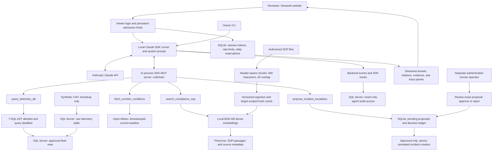

# Cold-Chain Claude MCP

A cold-chain logistics assistant built with Claude Agent SDK and in-process MCP tools. It combines historical synthetic fleet telemetry, current weather, and retrieved standard operating procedures (SOPs) to support incident assessment.

**Status — October 28, 2026:** Running locally in Docker with an authenticated Streamlit website at `http://127.0.0.1:8501`. Cloud deployment is deferred at the owner's request; no public demo URL exists. Portfolio documentation is included below; a demo recording is out of scope.

The agent uses Claude Agent SDK with an in-process MCP server exposing three evidence tools for telemetry, weather, and SOP retrieval, plus a fourth tool that stores a simulated escalation proposal for human review. Both the CLI and Streamlit frontend use a shared prompt and event interface. Imports make no model or network calls.

## Architecture and request flow



The SDK owns the model/tool loop: Claude requests an MCP tool, the application executes its validated service operation, and the SDK returns the result to Claude for the next turn. The MCP server runs inside the Python application; it is not a separate public endpoint. The website and CLI share the runner and prompt; website admission limits apply to the website entry point.

A typical assessment queries the permitted telemetry view, retrieves the relevant SOP clauses, and optionally fetches current weather. The answer cites returned policy metadata and distinguishes current weather from historical fleet observations. If the user requests escalation, the fourth tool stores a pending proposal. A separately authenticated operator reviews that exact proposal; approval creates one simulated internal incident through an atomic transaction. The model has no approval or execution tool. No driver or manager is contacted.

### Stack and tool boundaries

| Component | Implementation |
|---|---|
| Model and orchestration | Anthropic Claude, configured with `CLAUDE_MODEL=sonnet`; Claude Agent SDK `0.2.174`, `ClaudeSDKClient` |
| Tool transport | MCP `2.3.0`; `create_sdk_mcp_server`; four schema-validated tools |
| Website / owner interface | Streamlit; Python CLI using the same runner |
| Telemetry and audit | SQL Server 2022 Developer in Docker; SQLAlchemy, pyodbc, Microsoft ODBC Driver 18 |
| SOP retrieval | LangChain document/retrieval utilities, CPU BAAI/BGE-M3 dense 1,024-dimensional embeddings, Pinecone cosine top-2 retrieval |
| Splitting and ingestion | Markdown heading metadata plus recursive 600-character chunks with 60-character overlap; versioned chunks and scoped hash cache |
| Weather | Open-Meteo; wind-based demonstration disruption heuristic, not measured traffic |
| Cache | Ingestion hash cache and local model/runtime caches; no semantic answer cache |
| Authentication and state | Separate viewer/operator scrypt password hashes; hashed viewer session tokens and persistent SQLite admission/approval ledgers |
| Packaging | Docker Compose, persistent volumes, non-root web container; Caddy overlay prepared for future HTTPS hosting |

Only dense BGE-M3 vectors are used. Sparse embeddings, multi-vector retrieval, hybrid search, reranking, MMR, and deep-agent/multi-agent delegation are not implemented. LangChain provides retrieval utilities; Claude Agent SDK runs the agent loop.

| MCP tool | Data source or effect | Boundary |
|---|---|---|
| `query_telemetry_db` | SQL Server fleet view over four historical synthetic observations | One validated SELECT on the approved view; restricted database login |
| `fetch_corridor_conditions` | Current weather at validated latitude/longitude | Timestamped evidence; heuristic is explicitly labeled |
| `search_compliance_sop` | Existing authorized SOP chunks in Pinecone | Two passages with filename and heading metadata; retrieved text cannot grant permissions |
| `propose_incident_escalation` | Pending proposal in the local approval ledger | Cannot approve, notify anyone, or execute an operational action |

## Run the configured local demo

The current development copy already has its private configuration and model cache. Start its existing services without regenerating credentials:

```bash
docker compose -f compose.yaml -f compose.demo.yaml up -d sqlserver web
# Wait for SQL Server startup before checking readiness:
docker compose -f compose.yaml -f compose.demo.yaml exec -T web python -m scripts.deployment_check --deep
```

Open `http://127.0.0.1:8501`. Read the viewer credentials privately from the ignored `data/control/first-login.txt`; the approval operator has a different password. Never publish that file. The deep check verifies SQL view reads, audit insertion, local embeddings, actual Pinecone retrieval, and SDK startup; it does not make a model request or verify answer quality. Chat uses paid Anthropic API calls even though the website is local.

The website binds to loopback port 8501 and SQL Server to loopback port 1434. Docker must remain running. SQL data, approval/admission state, and runtime data use persistent volumes. To stop both application services while retaining data:

```bash
docker compose -f compose.yaml -f compose.demo.yaml stop web sqlserver
```

Avoid `down --volumes`, which deletes persistent data. For first-time Docker setup, embedding preparation, readiness, pause/resume, and deployment details, see [the deployment guide](docs/PART7.md). Native development setup follows below.

## Install and configure

Requires Python 3.12+, Docker for the local SQL Server, and ODBC Driver 18 for SQL Server on the host.

```bash
python3.12 -m venv .venv
source .venv/bin/activate
python -m pip install -r requirements.lock.txt
python -m pip install -e . --no-deps
python -m pip check
```

Copy `.env.example` to `.env` only when no local `.env` exists; supply credentials locally. The current development instance already has an ignored `.env`. Never overwrite its generated SQL passwords or commit it. `.env.example` documents all supported settings.

`src/config.py` resolves relative data paths from the project root. Supported embedding aliases include `Embeddings_model` and `Local_Embedding_Model`. Use the uppercase configuration names in the example for new setups.

## Isolated development resources

| Resource | Target |
|---|---|
| Docker Compose project | `cold-chain-claude-mcp` |
| SQL container | `cold-chain-claude-mcp-sqlserver-1` |
| Host address | `127.0.0.1:1434` |
| Docker data volume | `cold-chain-claude-mcp_sqlserver-data` |
| Application database | `cold_chain_claude_mcp` |
| Restricted login | `USR_CC_CLAUDE_RO` |
| Pinecone index | `cold-chain-claude-mcp-sop-local` |
| SOP namespace | `sop-v1` |

The SQL image uses amd64 emulation on Apple silicon. Its Developer edition is for development, not production licensing. Application engines use the dedicated database; an admin connection uses `master` only to create the database and login. Original database/index names are rejected by configuration.

Provisioning is explicit:

```bash
docker compose up -d --no-recreate sqlserver
python -m scripts.bootstrap_resources                 # display plan; no mutations
python -m scripts.bootstrap_resources --apply --component sql
python -m scripts.bootstrap_resources --apply --component pinecone
```

SQL bootstrap loads the four synthetic rows only if the raw table is absent, then applies the view and audit permissions. Re-running bootstrap preserves existing records. SQL passwords are read locally, never embedded in the SQL file. The Pinecone bootstrap validates dimension and metric and never deletes an incompatible index; it creates new indexes with deletion protection enabled.

After authorizing the policy text's transfer to Pinecone, ingestion is:

```bash
python -m scripts.ingest_sop_pinecone
```

The cache is scoped to index host, namespace, embedding settings, and splitter settings. Changed files upload versioned chunks before removing their previous tracked IDs. Failed uploads do not mark the changed file complete. Deletions only target tracked IDs in the configured namespace. No index recreation or broad namespace deletion is performed.

`python -m scripts.ingest_legacy_data` refuses to replace an existing telemetry table unless `--replace` is supplied. Its default input is the fabricated sample in `data/sample/`.

## Verify services independently

```bash
python -m unittest discover -s tests -v
python -m scripts.verify_services --live --skip-sop
# After authorized SOP ingestion:
python -m scripts.verify_services --live
```

The offline suite uses fixture data and injected dependencies. The live command contacts the dedicated SQL instance and weather service, writes a labeled audit event, checks permissions, and optionally retrieves SOP passages. It never invokes the agent or a chat model. Live results assume the four synthetic rows remain unchanged.

## Service boundaries

- `src/services/telemetry.py`: SQL view queries and bounded returned rows.
- `src/services/weather.py`: timestamped weather plus a clearly labeled wind-based demonstration heuristic.
- `src/services/sop.py`: lazy dense embedding model and Pinecone retrieval, preserving source metadata.
- `src/services/audit.py`: parameterized audit persistence and admin-only inspection interface.
- `src/services/observability.py`: request traces and SDK tool hooks with IDs, timings, usage/cost, redaction, and visible persistence failures.
- `src/services/approvals.py`: persistent local proposal/decision ledger and authenticated, atomic simulated incident creation.
- `src/services/documents.py`, `ingestion.py`, `loader.py`: document parsing and isolated ingestion.
- `src/agent_tools.py`: validated Claude SDK MCP adapters over the business services.
- `src/orchestrator.py`: shared Claude runner, streamed events, and isolated session continuation.
- `src/cli.py`: terminal chat and single-question entry point.
- `src/ui.py`: Streamlit frontend consuming the same runner as the CLI, plus an administrative audit viewer.

Set `ANTHROPIC_API_KEY` and `CLAUDE_MODEL` in `.env` before running the agent:

```bash
python -m src.cli
python -m src.cli --question "What is the fresh perishables temperature threshold?"
streamlit run src/ui.py
```

The CLI supports `/reset`, `/approvals`, and `/quit`. The UI supports New conversation. SDK session files stay under the ignored `data/cache/agent-runtime/` directory. No most-recent-global-session resume is used. Both entry points load the same system prompt. Restart the running app after changing `.env`; settings and service instances are cached per process. Backend tracing records request and tool lifecycles independently of the UI. SQL audit failures produce visible warnings. Approval decisions require their separate SQLite ledger to commit atomically.

For offline integration checks, run the unit tests. `python -m scripts.verify_sdk_runtime` checks bundled-runtime startup without a model request. The separate `python -m scripts.verify_agent --live` command makes paid Claude calls and sends retrieved evidence to Anthropic; use it only after authorizing that transfer. See `docs/PART3.md` and the Part 3 verification report for the exact verification status.

## Guardrails

SQL is parsed into an allowlisted T-SQL AST and regenerated before execution. Only one SELECT against the fleet view is allowed. Joins, nested queries, metadata/external sources, unknown functions, comments, and additional statements are rejected. Wildcards expand to the nine approved columns, and server/client row limits both apply. Row caps do not bound scan/sort cost: native SQL statement deadlines and query-specific cursor cancellation are separate controls.

Tools have bounded caller deadlines, shared request-call budgets, bounded worker capacity, output-size limits, and bounded transient retries (one attempt by default). Timed-out non-SQL threads retain their slots until finished; this prevents an unbounded queue but does not forcibly kill native embedding work. Configured credentials are redacted from tool/event/audit output, including streamed text.

Use `python -m scripts.verify_guardrails --live` for the dedicated database timeout/cancellation check. See `docs/PART4.md` for supported SQL, defaults, and precise limits.

Local embedding weights must be prepared before starting the agent. If not already cached, explicitly run `hf download BAAI/bge-m3 --cache-dir data/cache/embeddings` during setup; inference requests will not download them.

## Remaining phases and limitations

Approval is local and simulated. The current demo already has separate viewer/operator credentials; fresh setups must configure them before use. See [approval controls](docs/PART5.md). The evaluation harness and local Docker workflow are verified. External deployment is deferred; no public URL or production hosting claim is made. This implementation is not a general-purpose SQL sandbox or a hard CPU/memory isolation boundary.

Fleet fixtures are fabricated historical data. Current weather cannot establish historical causation. This is a single-agent SDK implementation. No multi-agent system or public deployment is claimed. The small evaluation baseline measures specific checks, not general accuracy or human-reviewed faithfulness.

See `docs/PART7.md`, `docs/PART6.md`, `docs/PART5.md`, `docs/PART4.md`, and `docs/PART3.md` for current behavior; `docs/PART2.md` and `docs/BASELINE.md` record earlier phases. `docs/VERIFICATION.md` records the historical Part 1 checks.

### Limits and remaining work

- The SQL Server permissions are the database boundary: SELECT on the semantic view, explicit denial on the raw table and writes to `dbo`, and INSERT-only access to the separate audit table. The AST allowlist adds an application guard. SQL validation uses parsed statements and approved objects rather than a SELECT-prefix check alone. See [SQL setup](scripts/setup_security_and_view.sql) and [SQL policy](src/security/sql_policy.py).
- Native SQL deadlines/cancellation, row/output limits, tool worker capacity, turn limits, and SDK budgets reduce runaway work. A row cap does not bound query scan cost; a timed-out non-SQL worker is not forcibly terminated.
- Website defaults are one concurrent request, ten requests per shared reviewer per hour, a $0.15 SDK request budget, and $1.50/day in conservative admission reservations. Reservations are not actual billed spend; SDK budgets can be exceeded at turn boundaries. They do not cover owner CLI/evaluations or independent replicas.
- Audit persistence is best effort with visible failure warnings; it is not an immutable compliance log. Approval commits fail closed if the decision ledger cannot commit. OS administrators remain trusted.
- Telemetry has only four fabricated historical rows. Weather disruption is a demonstration heuristic, not a trained risk prediction or causal explanation. No real external notifications or operational incident execution are implemented.
- Human answer review, inherited SOP/code publication rights, external hosting, and a stable public URL remain outstanding. The Docker web image was verified locally on ARM64; native AMD64 deployment still needs verification. SQL Server Developer edition is for development/demo use, not a claimed production license.

Cloud discovery subsequently confirmed an existing Enterprise Knowledge Copilot Lightsail instance in the same AWS account. Lightsail reads worked despite the earlier EC2 policy denial, but its 2 GB host is undersized for this combined workload. No existing project was modified and no cold-chain cloud resources were created. The owner chose local execution for now; the earlier AWS blocker reports are historical evidence, not a claim that every AWS service is inaccessible.

## Evaluations

```bash
.venv/bin/python -m scripts.evaluate                       # 14 offline controls; 16 live cases skipped
.venv/bin/python -m scripts.evaluate --live-agent --live-retrieval --live-sql
```

Live agent mode makes 12 paid Claude requests with fixed synthetic/SOP evidence, fresh sessions, and $0.15 SDK budgets per case by default. Retrieval mode reads the existing authorized Pinecone index. SQL mode runs native checks against the isolated SQL instance. Outputs go to new timestamped directories and preserve case failures, answers, tool evidence, latency/cost, and version hashes. See `docs/PART6.md` before interpreting scores. The latest saved run is [part7-runtime-v1](docs/evals/part7-runtime-v1/report.json), dated October 28, 2026. Its results are summarized below.


### Measured results and interpretation

| Check | Latest recorded result | Scope |
|---|---|---|
| Versioned evaluation cases | 30/30 passed | 14 deterministic controls, 12 live Claude fixed-evidence agent cases, 4 live retrieval cases |
| Tool selection | 12/12 passed | Expected tool behavior across these agent cases, including a no-tool case |
| Grounded reference checks | 26/26 passed | Narrow expected-pattern checks; not a complete faithfulness score |
| SOP retrieval | 4/4 source-and-section hits at top-2 | Real BGE-M3/Pinecone retrieval; required clause terms also present in all 4 |
| Agent latency | p50 6.05 s; p95 14.21 s | Nearest-rank percentiles across 12 fresh fixed-evidence agent cases |
| Agent cost | $0.1121229 total | SDK-reported cost across those 12 cases; excludes other runs and service charges |
| Native SQL supplement | Passed | Real isolated SQL permissions and timeout/cancellation; separate from the 30-case denominator |
| Automated test suite | 92 tests passed at Part 7 verification | Separate unit/integration suite; [recorded verification](docs/PART7_STATUS.md) |

Agent evaluation uses fixed synthetic telemetry/weather and controlled SOP passages; the telemetry fixture uses the production parser/executor on SQLite rather than SQL Server. Actual Pinecone retrieval is measured separately in four cases. The native SQL supplement covers real SQL Server behavior. These results are not a 30-question real-fleet benchmark, a held-out generalization score, a human-reviewed faithfulness measurement, or a production latency SLA.

The first baseline exposed an evaluator false positive: “No incident was created” matched a positive-execution pattern. Scorer version 1.0.1 corrected it while retaining the original results. Qualitative inspection also found unsupported speculation about an empty telemetry result and a mismatch between requested and normalized SQL row limits; the prompt/output handling changed and the full Part 7 evaluation was rerun. Actual human review remains pending. See [evaluation methodology](docs/PART6.md) and the report's `release_gate` and provenance fields.

The [fresh-browser verification](docs/part7-browser-check.json) separately checked login, evidence panels, telemetry/weather/SOP tool use, and authenticated approval creating one simulated incident. This was automated browser QA, not independent human answer review. Resumed-session browser cost fields may be cumulative and must not be summed. The report records source hashes and a dirty working tree at evaluation time; the Git commit alone does not identify all evaluated changes.

## Implementation history

This project has its own application package, configuration, version history, SQL database, and Pinecone index. Its core components are the Claude Agent SDK loop, four MCP tools, dense SOP retrieval, database and tool execution controls, backend tracing, authenticated simulated approval, repeatable evaluations, and the local Docker website.

The implementation commits below are dated **October 28, 2026** and document the recorded development sequence.

| Stage | Recorded work | Evidence |
|---|---|---|
| Parts 1–2 | Project packaging, synthetic data, service boundaries, isolated SQL/Pinecone resources | `084bb47`, `0eb87cd`; [baseline](docs/BASELINE.md), [Part 2](docs/PART2_COMPLETION.md) |
| Part 3 | Shared Claude SDK loop, MCP tools, CLI/UI, authorized live workflow | `2c055a4`, `6e8fed8`; [Part 3](docs/PART3.md) |
| Part 4 | SQL AST validation, permissions, cancellation, bounded tools and redaction | `a082d01`; [Part 4](docs/PART4_COMPLETION.md) |
| Part 5 | Backend tracing and authenticated simulated incident approval | `0e06e52`; [Part 5](docs/PART5_COMPLETION.md) |
| Part 6 | Versioned evaluations, preserved scorer correction, results and limitations | `0f039a5`, `eddd145`; [Part 6](docs/PART6_COMPLETION.md) |
| Part 7 | Authenticated website, container readiness, refreshed evaluation and browser QA | `636d79b`; [guide](docs/PART7.md), [browser evidence](docs/part7-browser-check.json) |
| Part 8 | README architecture, results, setup, limitations, and resume wording | Documentation update; recording omitted at the owner's request |

The project uses synthetic telemetry fixtures. Cloud deployment and a public demo URL remain deferred.

## Resume wording for the current local project

**Cold-Chain Logistics Assistant — Claude Agent SDK, MCP, RAG, SQL Server, Docker**

- Built a cold-chain logistics assistant with Claude Agent SDK and four MCP tools for fleet telemetry, weather, BGE-M3/Pinecone SOP retrieval, and human-reviewed simulated escalation.
- Added SQL AST validation, restricted database permissions, query cancellation, backend audit tracing, and authenticated human approval with duplicate-execution prevention.
- Built a versioned 30-case evaluation suite; all defined checks passed in the recorded run, including 12/12 tool-selection checks and 4/4 SOP source-and-section retrieval hits at top-2; verified the application with 92 automated tests.

Use “runs locally in Docker” when discussing delivery status. Add “deployed” and a website link only after actual external deployment and verification. Do not claim general accuracy, operational business impact, a human-reviewed faithfulness score, or an unverified duration.
