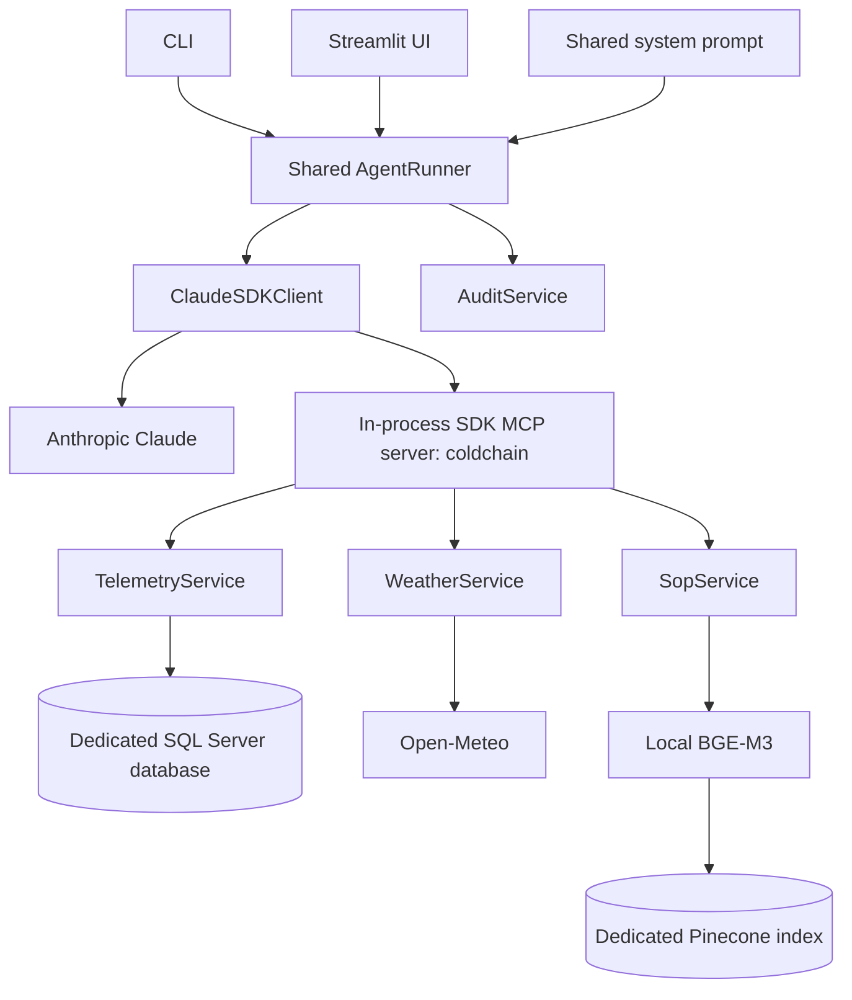

# Part 3 — Claude Agent SDK and MCP integration

## Implemented architecture



The SDK owns the reasoning/tool loop. There is no remaining LangGraph state graph, ToolNode, or tools_condition in the new implementation. LangChain packages remain for document splitting, embeddings, and Pinecone retrieval only. The original project is unchanged.

## Tools and result contract

`src/agent_tools.py` creates the three SDK MCP tools with JSON schemas. `create_business_mcp_server()` registers them with `create_sdk_mcp_server` under `coldchain`:

- `mcp__coldchain__query_telemetry_db`
- `mcp__coldchain__fetch_corridor_conditions`
- `mcp__coldchain__search_compliance_sop`

Each tool validates its inputs and returns JSON text with `ok` and `data`, or `ok=false` and a safe error. The SDK's `is_error` flag becomes an MCP error result. Telemetry results include historical/synthetic labeling; SOP results retain source and section metadata. The server is in-process, not a public HTTP MCP endpoint.

## Shared runner and sessions

`AgentRunner.stream_turn()` emits UI-independent session, text-delta, text, tool-start, tool-result, completion, error, and audit-warning events. Both `python -m src.cli` and `streamlit run src/ui.py` consume it. `src/prompts/system_prompt.txt` is loaded through the same function for both entry points, fixing the inherited UI prompt omission.

An application-created `AgentSession` holds its own SDK resume ID. A new SDK client is created per request using that exact ID when continuing a successful conversation; the implementation never uses the most-recent-global-session shortcut. Reset generates a fresh application identity and clears resume state. A per-session lock rejects overlapping requests. Failed or interrupted turns clear resume state to avoid silently continuing partial context.

SDK transcripts/configuration are kept under `data/cache/agent-runtime/<application-session>/`, excluded from Git. Reset changes the active session; it does not erase existing local transcript files. Runtime directories contain conversation evidence and should remain private. Restarting Streamlit loses its in-memory application-to-SDK session mapping; reconnecting users across restarts is not implemented.

## Runtime scope

`tools=[]` removes built-in tools. The callback accepts only the three exact MCP tool names; `allowed_tools=[]` ensures each call reaches that callback instead of being auto-approved before it. Unrelated built-ins are also explicitly denied. `setting_sources=[]`, `skills=[]`, no plugins/subagents, and strict MCP configuration prevent loading unrelated project configuration. The API endpoint and isolated runtime directory are set explicitly.

Basic request bounds use SDK max turns, reported budget enforcement, and an application deadline. They are not SQL execution cancellation or a complete production sandbox; Part 4 remains responsible for those stronger controls. The agent has no operational write/notification tool, and recommendations do not execute real-world actions.

## Configuration and usage

Set `ANTHROPIC_API_KEY` in the ignored `.env` file. `CLAUDE_MODEL=sonnet` uses the SDK alias; choose an explicit supported model ID when reproducibility requires pinning. The default bounds are 8 model turns, a $0.50 SDK budget, and 120 seconds per request. Model availability and billing depend on the supplied account.

```bash
python -m src.cli
python -m src.cli --question "What is the SOP temperature threshold?"
python -m src.cli --question "What is the SOP temperature threshold?" --json-events
streamlit run src/ui.py
```

Restart a running application after changing `.env`, because configuration is cached per process. CLI `/reset` and the UI's New conversation button start fresh sessions. The CLI entry point `cold-chain-chat` is installed by the package. The audit viewer requires the local admin credentials. It is a development interface, not a production authentication system.

## Verification boundaries

The offline suite exercises actual MCP discovery/calls over in-memory protocol streams, input validation, source metadata, safe failures, SDK option restrictions, fake-client session continuation/reset, stream normalization, timeouts, and frontend rendering/reset using Streamlit AppTest.

`python -m scripts.verify_sdk_runtime` starts the bundled runtime and checks initialization without sending a model request or using a real API key. The CLI may report no MCP servers before a query; this check does not establish end-to-end tool execution.

`python -m scripts.verify_agent --live --output docs/part3-live-check.json` is the explicit live smoke command. It sends synthetic fleet results, weather readings, and retrieved SOP excerpts to Anthropic, incurs usage, exercises all three MCP tools, checks a source citation, and follows up in the same SDK session. Run it only with authorized data and a configured key. One successful scenario is not an evaluation harness or an accuracy score.

Part 4 remains a separate step requiring confirmation.

## References

- [Official Python SDK](https://github.com/anthropics/claude-agent-sdk-python)
- [Permission evaluation](https://code.claude.com/docs/en/agent-sdk/permissions)
- [Session behavior](https://code.claude.com/docs/en/agent-sdk/sessions)
- [Streaming output](https://code.claude.com/docs/en/agent-sdk/streaming-output)
